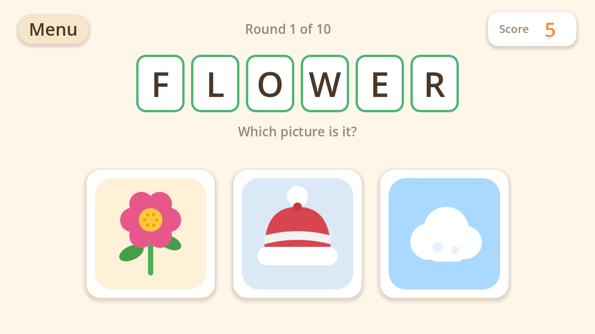
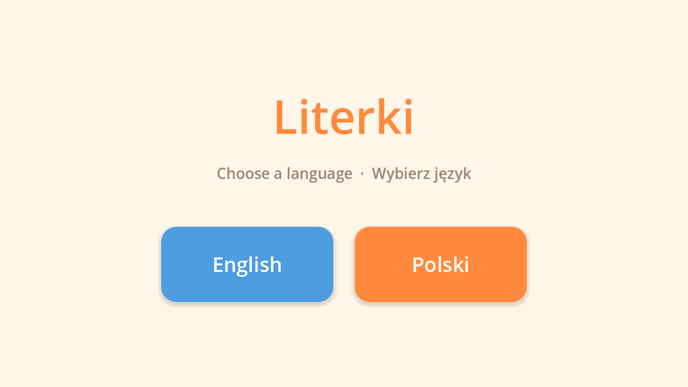
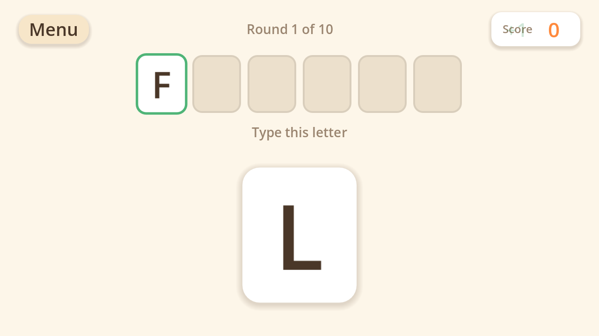
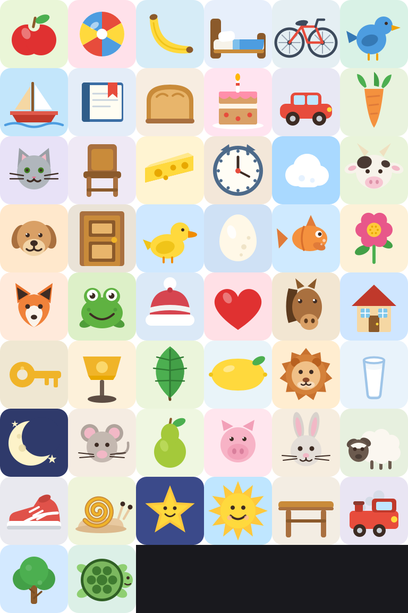

# Literki

A typing and reading game for young children, in **English** and **Polish**.



Each round shows one big letter at a time. The child types it, hears it spoken
aloud, and watches it fly up to join the word forming along the top of the
screen. When the word is finished the game spells it back, letter by letter —
but withholds the word itself. Then three pictures appear, and the child picks
the one the word describes; only once they have does the game finally say the
word. Working it out has to come from reading it, so hearing it is the reward
rather than the hint.

Ten rounds make a game, and the score goes on the board at the end. There are
fifty words in each language — animals, food, things around the house, weather —
and a game never repeats one.

| | |
|---|---|
|  |  |
| Pick a language to start | Letters fly up as they are typed |

## Scoring

| | |
|---|---|
| Correct letter | **+1** |
| Wrong letter | **−1** |
| Right picture, first try | **+3** |
| Right picture, second try | **+2** |
| Right picture, third try | **+1** |

A wrong picture is greyed out and the child keeps choosing, so a round always
ends by getting it right. The running total sits in the top corner throughout.

## Requirements

- [Godot 4.6](https://godotengine.org/) or newer

Every letter and word is a recording that ships with the game, so it sounds
the same on every machine and in every browser, with nothing to configure.

## Running

```bash
godot --path .
```

The macOS build ships as an app bundle with nothing on `PATH`, so `godot` is
not a command until you make it one:

```bash
ln -sf /Applications/Godot.app/Contents/MacOS/Godot ~/.local/bin/godot
```

Or call the binary inside the bundle directly:

```bash
/Applications/Godot.app/Contents/MacOS/Godot --path .
```

## Playing it on the web

Live at **https://literki.melinakrzemowa.pl**, deployed from `main` by
[.github/workflows/deploy.yml](.github/workflows/deploy.yml): the workflow runs
the tests, exports the web build, ships an nginx image to GHCR and pulls it on
the Air. Host wiring (tunnel route, compose file, port 4012) lives in
[melinakrzemowa/air-infra](https://github.com/melinakrzemowa/air-infra).

The export has thread support switched off deliberately. Godot's threaded web
build needs `Cross-Origin-Opener-Policy` and `Cross-Origin-Embedder-Policy` on
every response; without threads it is ordinary static files behind any web
server. The 36 MB wasm is gzipped at image build time, which takes it to about
9 MB over the wire.

To try a web build locally:

```bash
godot --headless --export-release "Web" build/web/index.html
python3 -m http.server 8099 -d build/web
```

## Tests

Game rules live in plain classes with no nodes in them, so a whole ten-round
game can be played out without a window:

```bash
godot --headless --script tests/run_tests.gd --quit
```

There is also a tour that drives the real screens with real key presses and
saves a screenshot at each step — useful for seeing a change rather than
reasoning about it:

```bash
godot --path . tools/tour.tscn -- /tmp/shots
```

Add `play` to play all ten rounds through the interface and check the score,
the round counter and the saved highscore:

```bash
godot --path . tools/tour.tscn -- /tmp/shots play
```

## Pictures

The fifty pictures are generated rather than hand-drawn, which is what keeps
them looking like one set:

```bash
python3 tools/generate_images.py
```



To look at them all at once:

```bash
godot --headless --script tools/preview_images.gd --quit -- /tmp/sheet.png
```

## Speech

Everything the game says was recorded with [ElevenLabs](https://elevenlabs.io):
a soft woman's voice from a native speaker of each language — Maria for Polish,
Luna for English. 158 clips: every letter of both alphabets and every word.

```bash
ELEVENLABS_API_KEY=... python3 tools/record_speech.py
```

That records only what is missing or out of date, so after adding a word it
costs one short request. Then let it listen to its own work:

```bash
ELEVENLABS_API_KEY=... python3 tools/record_speech.py --check --retake 6
```

`--check` plays each clip to ElevenLabs' transcriber after a carrier phrase
("Litera …", "The word …") and lists any it did not hear as intended;
`--retake` records those again until one comes back right. A voice reads the
same text a little differently every time, so a handful of clips in each run
need a second take. Whatever is still flagged after that, listen to yourself.

How each letter is read is set in `LETTERS` in the tool. Polish letters are
read by their names ("be", "ce", "eł"), except Y, which is its sound, and Ó,
which is a plain "u" rather than "u kreskowane". A letter or word with no
recording falls back to the operating system's synthesiser rather than
staying silent.

## Adding a language

Every picture is shared across languages, so a new language is a column of
words rather than a new set of drawings:

1. Add the two-letter code to `WordBank.LANGUAGES` and a name to
   `WordBank.LANGUAGE_NAMES`.
2. Add a word for each concept in `WordBank.CONCEPTS`.
3. Add the interface strings to `Texts.STRINGS`.
4. Add a voice to `VOICES` and the alphabet to `LETTERS` in
   `tools/record_speech.py`, and run it.

The tests will tell you if you missed one.

## Notes

- Polish is recorded on `eleven_multilingual_v2`, not the newer `eleven_v4`
  English uses: Maria is a Polish speaker, but on v4 she sounded English to
  Polish ears. v2 has no language setting and guesses from the text — a lone
  "lis" came out as English "lace" — so the tool hands it a Polish sentence as
  context. The transcriber check cannot hear an accent; only a person can.
- The synthesiser fallback needs a display server: `--headless` reports zero
  voices. Recordings play headless. Which system voice the fallback uses is
  decided in `Speech.PREFERRED_VOICES`, by display name, and
  `tools/check_voices.sh` shows how a system voice reads each letter without
  anyone having to listen.
- Polish words are shown and spoken with their proper spelling, but the plain
  ASCII letter is accepted too — a child on a US keyboard can type `slonce` for
  `SŁOŃCE` and still see and hear it spelled correctly.
- Digits, punctuation and the space bar are ignored rather than penalised. Only
  letter keys can cost a point.
- Scores can go negative, as specified. `Scoring.ALLOW_NEGATIVE_TOTAL` makes the
  game stop at zero instead.
